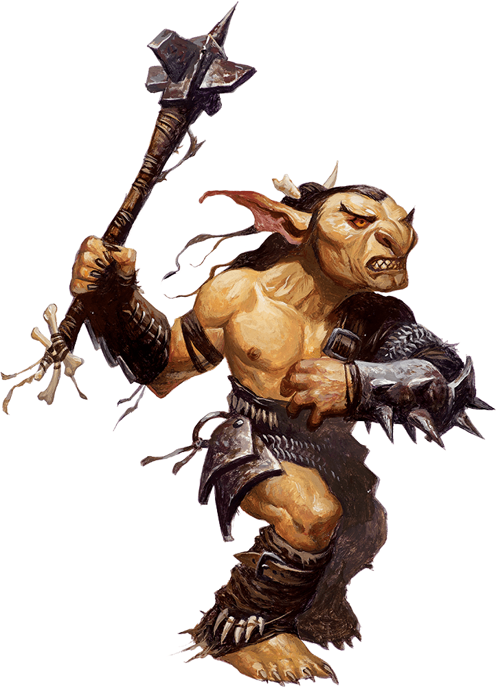

# Building Jebs Cabin Adventure

## 1. Add the map and location file

Put `Jebs Cabin.png` in `library/maps/`.


Create `library/locations/Jebs Cabin.json` with the image path and the
requested width in game feet.

```json
{
  "file": "../maps/Jebs Cabin.png",
  "widthFeet": 110
}
```

*Note on width:* The slicer scales the image to the requested width while
preserving its aspect ratio. If that would make the map too tall for the
printable layout, it scales both dimensions down until the height fits. Also
the slicer may crop the width or height a bit to ensure that the final
scaled map fits the grid evenly.

Add the location to the encounter's `maps` array in
`adventures/Jebs Cabin.adventure.json`.

```json
{ "location": "../library/locations/Jebs Cabin.json" }
```

Both `library/maps/` and `library/locations/` can have subfolders. The
`location` path is relative to the adventure JSON, and the `file` path is
relative to the location JSON. For example, if both files go into a
`Forest/` subfolder under their respective library folders:

- Use `../library/locations/Forest/Jebs Cabin.json` for `location`.
- Use `../../maps/Forest/Jebs Cabin.png` for `file`.

## 2. Add the creatures

Put the Goblin portrait in `library/portraits/goblin-2014.png`.



Create `library/creatures/goblin-2014.json` with the creature's name, size,
type, and portrait path. The portrait path is relative to the creature JSON.

```json
{
  "name": "Goblin",
  "size": "small",
  "type": "humanoid",
  "portrait": "../portraits/goblin-2014.png",
  "height": "4-6"
}
```

*Note on height: `height` is optional. Here, `"4-6"` means 4 feet 6 inches. An encounter can
override it by supplying its own `height`. If Height is omitted, the creature
height is determined by the creature size: tiny, small, medium, etc. Also, the height is a raw picture
scaling. in this case we specified 4'-6" for the goblin because he has a raised weapon. I choose
the scaling that makes his head come out at about 3 feet tall*

This encounter also uses the [Hobgoblin Devastator](../../library/creatures/hobgoblin-devastator-2016.json),
[Hobgoblin](../../library/creatures/hobgoblin-2014.json), and
[Bugbear](../../library/creatures/bugbear-2014.json) from the library.

## 3. Assemble the encounter

Save the following as `adventures/Jebs Cabin.adventure.json`. The adventure
title is **Jebs Cabin**. Its first encounter, `ENC1`, is named **Cabin in the
Woods**. The location and creature paths are relative to this adventure file.

```json
{
  "title": "Jebs Cabin",
  "encounters": [
    {
      "id": "ENC1",
      "name": "Cabin in the Woods",
      "maps": [
        {
          "location": "../library/locations/Jebs Cabin.json"
        }
      ],
      "portraits": [
        {
          "creature": "../library/creatures/hobgoblin-devastator-2016.json",
          "tokenId": "A1"
        },
        {
          "creature": "../library/creatures/hobgoblin-2014.json",
          "tokenId": "B",
          "qty": 2
        },
        {
          "creature": "../library/creatures/bugbear-2014.json",
          "tokenId": "C1"
        },
        {
          "creature": "../library/creatures/goblin-2014.json",
          "tokenId": "E",
          "qty": 5
        }
      ]
    }
  ]
}
```

*NOTE: The Hobgoblin group uses `"tokenId": "B"` and `"qty": 2` to create cards
`B1` and `B2`. The Goblin group uses `E` and a quantity of five to create
`E1` through `E5`. The Devastator and Bugbear use their exact IDs, `A1` and
`C1`, because those entries omit `qty`.  If you use `qty`, the composite overview
picture that shows the lineup will only show the portrait for goblins. The rest of
the portrai cards, will include an individual card for each creature regardless of
`qty` being specified.

## 4. Build the adventure

From the repository root, run:

```bat
bin\process_adventure.bat "Jebs Cabin"
```

```sh
sh bin/process_adventure.sh "Jebs Cabin"
```

The command finds `adventures/Jebs Cabin.adventure.json` and writes PDFs to
`out/<YYMMDD> - Jebs Cabin/`. This adventure omits the date, so the folder uses
today's local date unless you supply `--date YYMMDD`. The library files stay
in place.

The selected adventure template controls which PDFs you get. To choose an
output mode explicitly, copy
[`T000.json`](src/Adventure.Cli/Templates/T000.json) to
`cabin-output.json` in the repository root. Set `individualPDF` to `true`
for separate files or `false` for a merged file per encounter, then run:

```bat
bin\process_adventure.bat "Jebs Cabin" --template cabin-output.json
```

```sh
sh bin/process_adventure.sh "Jebs Cabin" --template cabin-output.json
```

## 5. Read the result

Open `out/<YYMMDD> - Jebs Cabin/` from the repository root. The date prefix
is the date used for the build. The folder contains the following PDFs,
depending on the output mode.

- **Separate output** produces `ENC1 - Cabin in the Woods - Maps.pdf` and
  `ENC1 - Cabin in the Woods - Portraits.pdf`.
- **Merged output** produces `ENC1 - Cabin in the Woods - Adventure.pdf`,
  with the map pages followed by the portrait pages.

The map and portrait overviews share the heading
**Jebs Cabin - ENC1 - Cabin in the Woods**. The portrait overview shows
four labels, `A1`, `B`, `C1`, and `E`. The portrait pages include all nine
cards, one for each numbered token.

## 6. Package the project

The files you assembled in steps 1 through 3 make up the project. Keep
the adventure in `adventures/`, the location and creature JSON files in
their library folders, and the images in `library/maps/` and
`library/portraits/`. Use relative paths with forward slashes so the
references work on Windows and macOS.

From the repository root, export the project:

```bat
bin\process_adventure.bat "Jebs Cabin" --export "Jebs Cabin.dndts" --verbose
```

```sh
sh bin/process_adventure.sh "Jebs Cabin" --export "Jebs Cabin.dndts" --verbose
```

The `.dndts` file is a ZIP archive. Export follows the adventure's
references and includes each required file once. Use a new filename if a
bundle with that name already exists. With `--verbose`, the command prints
the archive tree:

```text
Jebs Cabin.dndts
├── adventures/
│   └── Jebs Cabin.adventure.json
└── library/
    ├── creatures/
    │   ├── bugbear-2014.json
    │   ├── goblin-2014.json
    │   ├── hobgoblin-2014.json
    │   └── hobgoblin-devastator-2016.json
    ├── locations/
    │   └── Jebs Cabin.json
    ├── maps/
    │   └── Jebs Cabin.png
    └── portraits/
        ├── bugbear-2014.png
        ├── goblin-2014.png
        ├── hobgoblin-2014.png
        └── hobgoblin-devastator-2016.webp
```

## 7. Build from the project bundle

Put the bundle in the receiving workspace and run:

```bat
bin\process_adventure.bat -f "Jebs Cabin.dndts"
```

```sh
sh bin/process_adventure.sh -f "Jebs Cabin.dndts"
```

The command uses the assets in the bundle and writes PDFs to `out/`.
After a successful build, enter `v` at the import prompt to preview the
library tree, then answer `y` to import or press Enter to decline. The
import skips identical files and asks before replacing files that differ.
The adventure JSON stays in the bundle.
